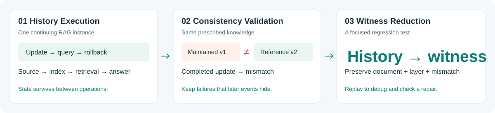

<div align="center">

# RAGWitness

**Testing Knowledge Updates in Stateful RAG Systems**

[Interactive demo](demo/index.html) · [Quick start](#quick-start) · [Baseline comparison](#how-does-it-compare) · [Evidence guide](docs/EVIDENCE.md) · [Reproduction](docs/REPRODUCING.md)

</div>



## A correct answer does not always mean a correct update

A policy changes from a **$10 fee to $20**. The application acknowledges the update,
but its index still contains the old policy. Asked who owns the policy, it gives
the same correct answer: **Atlas**. Later, a rollback restores the original policy,
and even the final state looks correct.

**The update failed in between.** Checking answers alone—or checking only the end
of the history—can miss it. RAGWitness tests the update process itself and keeps
the evidence of a failure even when later operations hide it.

> **Try the story:** open [demo/index.html](demo/index.html) locally, choose a fault,
> and press **Play history**. Watch the maintained index, the fresh reference,
> and the failure ledger change together. The demo uses replay data generated by
> the real Python implementation, not a live LLM or a simulated RAG-MT judge.

## What RAGWitness adds

| Stage | What it does | Why it matters |
| :--- | :--- | :--- |
| **1 · History Execution** | Runs legal updates, replays, rollbacks and queries on one continuing instance. | Exercises dependencies that isolated builds do not expose. |
| **2 · Consistency Validation** | At completed checkpoints, compares observable state against a fresh build of the prescribed knowledge. | Detects missing, stale or incoherent state before an answer happens to expose it. |
| **3 · Witness Reduction** | Removes events while preserving the selected document, layer and mismatch signature, plus applicable completion obligations. | Turns a long execution into a focused, replayable regression test. |

For developers, the output is a **failure witness**, not just a score: which
document and state layer diverged, after which completed operation, and which
short history still reproduces the problem. Replaying the original history after
a patch checks whether the repair also satisfies the surrounding update workflow.

## How does it compare?

**Matched Chroma/Contriever update histories:** 40 seeded conditions, 10 clean
controls, the same checkpoints and four query probes per checkpoint.

| Method | Role | Detected at any completed checkpoint | Detected only at the endpoint |
| :--- | :--- | ---: | ---: |
| RAG-MT · DeepSeek | Published answer-focused baseline, adapted to the update histories | 28/40 · 70.0% | 3/40 · 7.5% |
| RAG-MT · Kimi | Same baseline with another target model | 24/40 · 60.0% | 3/40 · 7.5% |
| Query-evidence comparison | Observation control | 39/40 · 97.5% | 16/40 · 40.0% |
| **RAGWitness** | **State consistency + failure ledger** | **39/40 · 97.5%** | **16/40 · 40.0%** |

RAGWitness detects **97.5%**, versus **65.0% on average** for RAG-MT across the two
model settings. Endpoint-only checking is an ablation, not a separate published
method. Query-evidence comparison ties state checking in this well-probed cohort;
the broader observation matrix studies how coverage changes with retrieval depth.
A complete white-box audit with the same state access also matches state checking.
The contribution is the history-sensitive testing and diagnostic workflow, not
a claim to outperform every possible state oracle.

RAG-MT is the framework in *When Knowledge Changes: Metamorphic Testing of RAG
Systems with Mutations*. Here its answer relationships are applied to the
maintained execution. See [the comparison protocol and clean-control results](docs/EVIDENCE.md#baseline-protocol).
The 40 conditions are repeated configurations over five cases, not 40 independent
real-world bugs. All table values are recomputed by `python3 bin/check_results.py`.

## Evidence at a glance

| Question | Recorded result | Practical takeaway |
| :--- | :--- | :--- |
| Does history matter? | Chroma and Qdrant each detect **39/40** conditions at checkpoints, versus **16/40** at the endpoint. | A later operation can hide an earlier maintenance failure. |
| Does reduction preserve the problem? | **358/358** observed failures retain the selected signature, versus **54/358** with an any-failure reducer; witnesses contain **1–4 events**. | A short failing test should still diagnose the original problem. |
| Does it help with real repairs? | Four representative historical LangChain/LlamaIndex cases; three repairs satisfy the tested histories, while one retains a recovery/retry failure. | Validate both the local fix and the surrounding workflow. |

The study also varies history length, retrieval depth, backend and corpus size.
This review repository contains selected frozen evidence and executable core code;
it is **not an assertion that every study has been re-executed in a clean container**.
[Evidence coverage and exact reproduction levels →](docs/REPRODUCING.md)

## Quick start

### 1. Verify the release and recompute the headline results

Python **3.10+**, standard library only. No installation, network or API key.

```bash
python3 bin/verify_release.py
python3 bin/check_results.py
```

Expected: both commands print `"valid": true`. The second recomputes the comparison,
history and reduction counts from the packaged records, rather than trusting a
hand-written result table.

### 2. Explore the demo

Open `demo/index.html` directly in a browser, or serve the repository locally:

```bash
python3 -m http.server 8000 --bind 127.0.0.1
# Visit http://127.0.0.1:8000/demo/
```

No tracking, remote fonts, CDN, model calls or credentials. Choose **Dropped update**,
**Orphaned old chunks**, **Stale query cache**, or **Clean execution**. The UI displays
the selected failure signature and the actual reduced event history.

### 3. Execute the core and regenerate the demo

Dependency installation needs network access once; execution is local afterward.

```bash
python3 -m venv .venv
. .venv/bin/activate
python -m pip install -r requirements-demo.txt
python demo/run_demo.py --output verification-output/demo
python bin/run_histories.py --cases 1 --reduce
PYTHONPATH=src python -m pytest -q tests
```

The replay output goes to `verification-output/`, leaving the shipped evidence
unchanged. The demo uses the actual BM25-backed history interpreter, state
observer and signature-preserving reducer. Its answer display is a deterministic
field extraction for teaching the example; it is **not a new model experiment**.
The history runner additionally executes the study's 32-event generator across
both schedules and all six fault profiles, with a clean control for each schedule.

## Real-world debugging

Two examples illustrate the intended use:

- **LangChain · 14 → 4 events.** A failed vector deletion and retry leave a stale
  vector after bookkeeping is removed too early. The reduced witness isolates
  the interaction; replay confirms the upstream repair on the tested history.
- **LlamaIndex · 11 → 4 events.** The patch fixes premature document publication
  on failure, but the tested historical pipeline still retains a deduplication
  hash that skips the recovery retry. RAGWitness confirms the local rollback and
  exposes the remaining workflow failure. Source inspection corroborates it.

[Case descriptions, upstream links and repair outcomes →](docs/REAL_WORLD.md)

## Repository map

```text
demo/                 Interactive replay + executable example generator
src/ragmetatest/      Framework, retriever adapters and experiment components
tests/                Portable core regression tests
evidence/             Frozen matched-comparison, history and repair records
bin/                  Integrity and result-recomputation commands
docs/                 Evidence map, case studies and reproduction scope
assets/               Repository-native overview graphic
SOURCE_MAP.json       Source-to-release hashes and sanitization provenance
MANIFEST.sha256       Integrity manifest for this release
```

The framework is named **RAGWitness**; the Python namespace remains `ragmetatest`
to preserve compatibility with recorded experiments. The source and data map is
explicit so reviewers can move from a claim to its inputs without browsing an
unfiltered experiment workspace.

## Anonymous release and license

This repository accompanies **Same Knowledge, Different State: Testing Knowledge
Updates in Stateful RAG Systems**. Author information is withheld for anonymous
review. No submission status or artifact badge is claimed.

Original framework code is covered by the existing [MIT license](LICENSE).
[Third-party provenance](THIRD_PARTY.md) explains the reference implementation,
data and upstream case records. No upstream source without a redistribution
license, model weights, credentials, private review logs or Git history are included.
